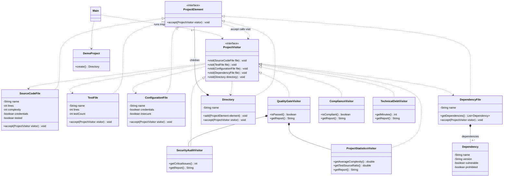
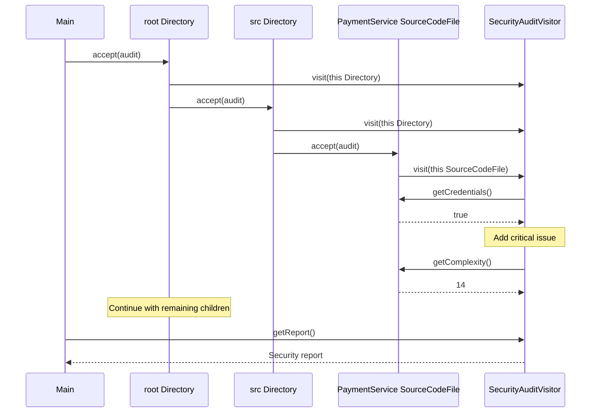

# Smart Code Inspection and Compliance Engine

Assignment 6 demonstrates the Visitor pattern in Java 17. The engine applies five operations to the same project tree: security audit, statistics, release quality, compliance, and technical debt estimation.

The project uses manually supplied file metadata. It does not read Java files, detect real passwords, or query a vulnerability database. Dependency names and security flags in the demo are sample data.

## Run

Install JDK 17 or newer and Maven 3. Run these commands from the repository directory:

```sh
mvn test
mvn compile exec:java
```

In IntelliJ IDEA, open `pom.xml` as a Maven project, select JDK 17 or newer as the project SDK, and run `Main.main()`. The application needs no arguments.

## Project structure

All Java classes are in `org.example.inspection`.

- `ProjectElement` declares `accept(ProjectVisitor)`.
- `SourceCodeFile`, `TestFile`, `ConfigurationFile`, `DependencyFile`, and `Directory` implement it.
- `Dependency` stores one library's name, version, and two flags. It is data inside a dependency file, not a separate visited element.
- `ProjectVisitor` declares one overloaded `visit` method per element type.
- Five concrete visitors contain the inspection rules.
- `DemoProject` builds the sample tree and `Main` runs each visitor.

`Directory.accept()` first visits the directory, then calls `accept()` on every child. Nested directories use the same method recursively. Visitors do not repeat this traversal. Empty directory visits are valid even when an operation has nothing to calculate for the directory itself.

## Demo project

```text
fintech-project/
  src/
    PaymentService.java
    UserService.java
  tests/
    PaymentServiceTest.java
  config/
    application.properties
  pom.xml
```

PaymentService has 150 lines, complexity 14, hardcoded credentials, and tests. UserService has 100 lines, complexity 8, no credentials, and no tests. The test file has 70 lines and 5 test methods. Configuration exposes credentials and is insecure. The dependency file has three libraries: one safe, one vulnerable, and one prohibited with a missing version.

The tree is a model stored in memory. The file names above are represented by element objects.

## Inspection rules

| Visitor | Rules |
| --- | --- |
| SecurityAuditVisitor | Source credentials, exposed configuration credentials, insecure configuration, and each vulnerable dependency are critical issues. Source complexity above 15 produces a warning. |
| ProjectStatisticsVisitor | Counts files, source and test lines, source files, test files, test methods, dependencies, and source complexity. Directories do not count as files. |
| QualityGateVisitor | Requires zero critical issues, average complexity at most 10, and test/source ratio at least 0.40. All three conditions must pass. |
| ComplianceVisitor | Rejects source or configuration credentials, production files marked as untested, missing dependency versions, and prohibited dependencies. |
| TechnicalDebtVisitor | Adds 30 minutes for each complexity point above 10, 120 minutes per source file without tests, and 60 minutes per vulnerable dependency. |

Average complexity is the sum of source complexity divided by source file count. Test/source ratio is test file count divided by source file count, not test method count or code coverage. Both values are zero when there are no source files. An empty project therefore fails the quality gate's test requirement.

The compliance rule uses the source file's `tested` flag. It does not match test file names to production file names. Lines are counted for source and test files only. Debt minutes are a simple exercise estimate.

Each visitor accumulates results during a traversal. Create a new visitor for another inspection; reusing one would add the next traversal to its existing results.

## Demo results

Running the five visitors on `DemoProject.create()` produces:

| Metric | Result |
| --- | --- |
| Critical security issues | 4 |
| Total files | 5 |
| Lines of code | 320 |
| Source files | 2 |
| Test files | 1 |
| Test methods | 5 |
| Dependencies | 3 |
| Average complexity | 11.00 |
| Test/source ratio | 0.50 |
| Compliance violations | 5 |
| Estimated technical debt | 300 minutes |

```text
Quality Gate
Security: FAIL
Complexity: FAIL
Tests: PASS
FINAL RESULT: FAILED
```

The demo intentionally fails release checks. Its debt estimate is 120 minutes for PaymentService complexity, 120 minutes for missing UserService tests, and 60 minutes for the vulnerable dependency.

## Class diagram

The diagram shows the main pattern relationships and selected members.



## Sequence diagram

This is the source-file part of a security traversal through the demo tree.



## Visitor questions

### What problem does Visitor solve

Different inspections operate on the same kinds of project files. Visitor keeps inspection rules outside the data classes, so adding another operation does not require adding another inspection method to every element.

### Where are Element and Visitor

`ProjectElement` and its five implementations are the element hierarchy. `ProjectVisitor` and its five implementations are the visitor hierarchy.

### What is double dispatch

First, Java selects the concrete element's `accept()` at runtime. Inside `SourceCodeFile.accept()`, `this` has the declared type `SourceCodeFile`, so the compiler selects `visit(SourceCodeFile)`. Runtime dispatch then selects that method on the actual visitor, such as `SecurityAuditVisitor`. The operation depends on both the element type and visitor type. No `instanceof` or type switch is needed.

### Why not put all operations inside elements

Security, statistics, compliance, and debt rules change for different reasons. Putting them in every element would mix data with inspection logic and spread one operation across several classes. Here, each operation is collected in its visitor.

### Is a new Visitor or a new Element easier

A new visitor is easier. Implement the five methods in a new class and call it from the client. Existing element classes stay unchanged. A new element requires extending the visitor interface and updating every visitor.

The additional `TechnicalDebtVisitor` was added in a separate commit along with its tests and demo call. No existing element class changed in that commit.

### What changes for DatabaseMigrationFile

Create `DatabaseMigrationFile implements ProjectElement` with its data and `accept()`. Add `void visit(DatabaseMigrationFile file)` to `ProjectVisitor`. Implement that method in all five concrete visitors. For `QualityGateVisitor`, decide whether to forward the migration to its security and statistics visitors. Existing visitors will fail compilation until their new method is implemented.

Existing element classes do not need changes. `Directory` already stores `ProjectElement` children, so it can contain migrations. Update the demo, tests, and UML to include the new type.

### When is Visitor a bad choice

Visitor is inconvenient when element types change often because each new type affects every visitor. For one simple operation, separate visitors may also add more classes than the project needs.

### How is Visitor different from Strategy

Strategy provides interchangeable ways to perform one task, such as choosing a payment algorithm. Visitor defines an operation across several different element types and uses their `accept()` methods to select the matching behavior.

### Which SOLID principles apply

Single Responsibility separates file data from inspection rules. Open Closed applies when adding operations through new visitors, although adding an element changes the visitor contract. Dependency Inversion is visible in `accept(ProjectVisitor)` and the directory's collection of `ProjectElement`: both use interfaces. The quality gate also reuses existing security and statistics visitors instead of copying their rules.

## Tests

The project contains 26 JUnit 5 tests. They check all five element types, nested and empty directories, security rules, statistics, quality gate PASS and FAIL, exact threshold values, compliance rules, negative input, missing versions, and technical debt.

Run `mvn test` to reproduce the checks. Tests assert values and decisions rather than only checking that objects exist.

## Submission

Use this public repository and its English README as the report. The README includes both required UML diagrams. Submit the repository link and README in Moodle according to the course instructions.

